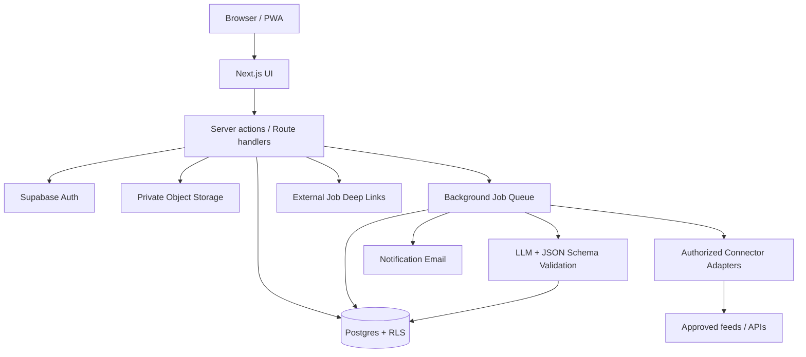

# CareerOS — Product Requirements Document (PRD)

> **Version:** 1.0 | **Date:** 21 October 2026 | **Status:** Proposed / Planning  
> **Product type:** Responsive web application / PWA  
> **Market:** Thailand-first; multilingual-ready (TH/EN)  
> **Design:** Apple iOS-inspired, original branding (not a replica of Apple's UI)

## 1. Executive summary

**CareerOS** คือแพลตฟอร์มจัดการเส้นทางการสมัครงานแบบครบวงจร (Personal Career Workspace) ที่ช่วยให้ผู้ใช้รวบรวมประกาศงานที่สนใจจาก JobsDB, JobBKK, JobThai, LinkedIn และแหล่งที่ได้รับอนุญาตอื่น ๆ ไว้ใน workspace เดียว วิเคราะห์ requirements ของบริษัทและแต่ละตำแหน่ง เปรียบเทียบกับทักษะส่วนตัว สร้างแผนเรียนและงานรายวัน แนะนำโปรเจกต์ Portfolio ที่ตอบโจทย์งานเป้าหมาย และบันทึกสถานะการสมัครงานตั้งแต่ค้นพบจนได้รับข้อเสนอ

**Value proposition:** เปลี่ยนจากการ “เก็บลิงก์สมัครงานกระจัดกระจาย” เป็นการ “รู้ว่าควรสมัครงานไหน เรียนอะไร ทำโปรเจกต์อะไร และต้องติดตามบริษัทไหนต่อ”

**Product principles:** User-owned career data; source attribution; explainable AI; privacy by default; no false auto-apply claims; compliant job integrations; human-in-the-loop.

## 2. ปัญหาและกลุ่มผู้ใช้

### 2.1 Pain points
- งานกระจายอยู่หลายเว็บไซต์ ค้นหาและตรวจสอบซ้ำ
- JD เขียนไม่เหมือนกัน ทำให้เห็นทักษะที่ตลาดต้องการภาพรวมได้ยาก
- ไม่รู้ว่าควรเติมทักษะไหนก่อน และควรทำ Portfolio แบบใด
- เรียนหลายอย่างแต่ไม่มีลำดับความสำคัญหรือเป้าหมายรายวัน
- จำไม่ได้ว่าสมัครบริษัทไหนแล้ว เอกสารเวอร์ชันไหน นัดสัมภาษณ์เมื่อไร
- ประเมินความคืบหน้าในการหางานจากข้อมูลจริงได้ยาก

### 2.2 Personas
1. **Student / New graduate:** ยังไม่มีประสบการณ์ ต้องการแผนเรียนและ Portfolio
2. **Career switcher:** ต้องเทียบทักษะเดิมกับงานสายใหม่และเห็น gap
3. **Active job seeker:** สมัครหลายบริษัท ต้องการ application CRM
4. **Passive candidate:** อยากเก็บงาน ติดตามแนวโน้มและเตรียมพร้อมก่อนสมัคร

## 3. Outcomes และตัวชี้วัด

### North Star Metric
**จำนวนสัปดาห์ที่ผู้ใช้ทำ Career Action ที่มีคุณภาพสำเร็จ** เช่น ทำ learning task, ส่งใบสมัครพร้อมหลักฐาน, ส่ง follow-up หรือปิด skill gap พร้อมหลักฐาน

### Product KPIs (เป้าหมายสมมติสำหรับทดลอง; ไม่ใช่ข้อมูลตลาดจริง)
| Metric | คำจำกัดความ | เป้าหมายเบื้องต้น |
|---|---|---|
| Activation | ตั้งค่าโปรไฟล์ + บันทึกงาน ≥3 รายการใน 7 วัน | ≥50% |
| Analysis adoption | วิเคราะห์ JD อย่างน้อย 1 รายการ | ≥40% ของ activated |
| Weekly engagement | มี career action ≥2 วันต่อสัปดาห์ | ≥35% ของ activated |
| Learning execution | ทำ daily tasks เสร็จตามแผน | ≥60% ต่อสัปดาห์ |
| Tracking coverage | ใบสมัครที่มีสถานะและวันที่ล่าสุด | ≥90% |
| AI trust | ผู้ใช้กดยอมรับ/แก้ไข skill extraction | ติดตามแยกตามรุ่นโมเดล |
| Job ingestion quality | Duplicate rate หลัง de-dup และ citation/source errors | ติดตามแบบรายวัน |

**Guardrail metrics:** ค่าใช้ AI/ผู้ใช้, latency, import failure, incorrect status inference, deletion requests, source compliance incidents.

## 4. Scope / Priorities

| Priority | Feature | MVP? |
|---|---|---|
| P0 | Authentication, onboarding, profile, target roles, career goals | Yes |
| P0 | Import งานด้วย URL/manual entry/paste JD ตามสิทธิที่เหมาะสม | Yes |
| P0 | Jobs inbox, search/filter/sort, saved jobs, source links | Yes |
| P0 | JD parsing, skill extraction, requirement evidence | Yes |
| P0 | Skill profile, skill gap, fit explanation | Yes |
| P0 | Learning roadmap + daily tasks + completion | Yes |
| P0 | Application tracker (table/kanban), notes, timeline, reminders | Yes |
| P0 | Responsive iOS-inspired UI, accessibility, privacy controls | Yes |
| P1 | Portfolio project recommender, milestones, rubric | Phase 2 |
| P1 | CV variants, cover letter drafts, document version association | Phase 2 |
| P1 | Import ผ่านอีเมล forwarded notifications / user-provided files | Phase 2 |
| P1 | Calendar sync, follow-up suggestions, analytics | Phase 2 |
| P1 | Approved partner job feeds and permissioned APIs | Subject to access |
| P2 | Browser extension save job (permission-reviewed) | Later |
| P2 | Semantic search, advanced salary insights, interview coach | Later |
| Out of scope | Auto-scraping restricted sources, CAPTCHA bypass, credential sharing | No |
| Out of scope | Auto-apply across platforms without permission or user review | No |
| Out of scope | Claiming an application is submitted without confirmed evidence | No |

## 5. Core user journeys

### 5.1 First-time onboarding
1. Sign up / sign in (email magic link or Google OAuth)
2. เลือกเป้าหมาย: เช่น Frontend, Full-stack, Data Analyst, UX/UI
3. ระบุ seniority, location, remote/hybrid/on-site, expected salary (optional), language, availability
4. เพิ่ม current skills พร้อม level (0–4), projects, CV (optional, consent required)
5. ตั้งเวลาที่เรียนได้ต่อวัน และ target application count ต่อสัปดาห์
6. ผู้ใช้เห็น dashboard แรก พร้อม checklist เริ่มต้น

### 5.2 Job discovery → analysis
1. ผู้ใช้เปิด jobs inbox หรือ import URL/JD
2. ระบบบันทึก source URL, source name, import method, imported_at และ provenance
3. Normalize fields และ de-duplicate ด้วย source ID (ถ้ามี) + canonical URL + fuzzy match แบบใช้เกณฑ์ระวัง false positive
4. เปิด job detail แสดง original content ที่อนุญาต, extracted requirements พร้อมข้อความอ้างอิงจาก JD ที่ผู้ใช้นำเข้าหรือแหล่งที่มีสิทธิ์, และ timestamps
5. เลือก Analyze → skill groups, required/preferred, experience, tools, language, degree, location/salary, unknowns
6. เปรียบเทียบกับ profile → gap, confidence และ next action
7. Save หรือ Create Application

### 5.3 Gap → daily learning plan
1. เลือกงานเดี่ยวหรือกลุ่ม target jobs
2. ระบบรวม requirements แบบถ่วงน้ำหนัก โดยไม่ให้ job ที่ซ้ำมีอิทธิพลเกินจริง
3. แนะนำ priorities (importance × frequency × gap × feasibility)
4. ผู้ใช้กำหนด study hours/week, deadline, days off, preferred learning format
5. AI สร้าง roadmap เป็น stages → weekly goals → daily tasks
6. แต่ละ task มี output ที่ตรวจได้, estimated effort, resources, link to target skill/job
7. ผู้ใช้ complete / defer / reschedule, เพิ่มหลักฐาน และปรับแผนรายสัปดาห์

### 5.4 Portfolio project planning
1. เลือก target role และกลุ่ม skill gaps
2. ระบบเสนอโปรเจกต์ 3 ระดับ: starter, portfolio-ready, stretch
3. แต่ละโปรเจกต์ระบุ business problem, target users, feature scope, skills demonstrated, stack, milestones, GitHub/deploy deliverables, acceptance criteria
4. ผู้ใช้เลือกและสร้าง task board; link โปรเจกต์กับ skill, job, และหลักฐาน
5. Project readiness ใช้ checklist/rubric ไม่ใช่การรับรองว่าบริษัทจะจ้าง

### 5.5 Application tracking
1. Create application จาก job หรือกรอกเอง
2. Attach CV version, portfolio links, notes, applied_at, submission evidence
3. เปลี่ยนสถานะด้วยตนเอง หรือจาก integration ที่ได้รับอนุญาตและยืนยันได้
4. Dashboard แสดง next action, deadline, reminders, follow-up history, interview schedule
5. ปิดผลลัพธ์ Hired / Rejected / Withdrawn / Archived และวิเคราะห์ conversion

## 6. Functional requirements

### FR-01 Authentication & account
- Passwordless email / OAuth; email verified; session management; logout all devices
- Multi-tenant isolation by user_id; account export and deletion; consent records
- Profile: role interests, job preferences, career goals, timezone, learning availability

### FR-02 Job source connectors
**Connector abstraction:** `SearchLinkConnector`, `ManualImportConnector`, `AuthorizedApiConnector`, `EmailImportConnector` (P1), `BrowserExtensionConnector` (P2)
- Source status field: `link_only | manual | permitted_feed | authorized_api | unavailable`
- ทุกงานต้องมี source URL / attribution เมื่อทราบ
- หากไม่ได้รับอนุญาต API หรือดึงรายละเอียดไม่ได้: แสดง deep link เพื่อเปิดต้นทางและให้ผู้ใช้กรอก/วางข้อมูลเองตามเงื่อนไขที่ใช้บังคับ
- ห้ามแสดงว่างานทุกเว็บ sync สดโดยไม่มี connector ที่ทำงานจริง
- กำหนด connector config (capabilities, access scopes, rate limits, allowed fields, retention, expiry)
- จัดการ API failures, stale/expired listing, retries, circuit breakers และ manual fallback
- Dedup across feeds โดยเก็บ provenance ต่อ source ไม่ merge ข้อมูลจนสูญเสีย origin
- เก็บเฉพาะข้อมูลและระยะเวลาที่มีสิทธิ์จัดเก็บ โดยเฉพาะ third-party content

**Integration matrix (สถานะ ณ 21 ต.ค. 2026; ต้องตรวจสอบก่อน production):**
| Source | MVP approach | Future integration | Important constraint |
|---|---|---|---|
| JobsDB Thailand (SEEK) | Search/deep link + user-provided details | Seek partner approval and eligible use-case | SEEK Developer API exists, but primarily documents recruitment software integrations; do **not** infer open job-search feed access |
| JobBKK | Search/deep link + manual save | Contact platform for written API/feed agreement | No public general-purpose job-search API verified in this assessment |
| JobThai | Search/deep link + manual save | Contact platform for written API/feed agreement | No public general-purpose job-search API verified in this assessment |
| LinkedIn Jobs | Deep link and user-entered application metadata; carefully review content handling | Only explicitly approved partner use-case | Job Posting API is vetted and designed for posting workflows, not a general-purpose candidate job-search API; LinkedIn disallows unauthorized scraping and restricts storage/aggregation |

**Important implementation rule:** การนำเข้าเนื้อหา JD จากผู้ใช้ก็ต้องตรวจสอบข้อกำหนดแหล่งข้อมูล/ลิขสิทธิ์ด้วย อย่าใช้ user paste เป็นวิธีหลบข้อจำกัดของแพลตฟอร์ม; สำหรับ LinkedIn หลีกเลี่ยงการบันทึก/ประมวลผลเนื้อหาที่เข้าข่าย restricted platform content จนกว่าจะได้รับการอนุญาตหรือคำแนะนำกฎหมายชัดเจน. MVP ยังคงรองรับการบันทึกข้อมูลที่ผู้ใช้สร้างเอง เช่น ชื่อบริษัท ตำแหน่ง วันที่สมัคร และบันทึกส่วนตัว

### FR-03 Jobs Inbox / Search
- Tabs: Discover, Saved, Analyzed, Applications
- Search by title/company/keyword and filters: source, seniority, location, remote, salary, posted date, tech stack, match status
- Views: list cards and compact table; sorting by recency, relevance (where supported), salary (only if disclosed)
- Chips: `New`, `Saved`, `Analyzed`, `Applied`, `Expired`, `Source unverified`
- Job detail includes original source link, notes, requirements, matching insights, actions
- Never silently fabricate salaries or posting dates

### FR-04 Job Description Intelligence
- Import English/Thai text; detect language; structure JD into standardized schema
- Extract hard skills, soft skills, frameworks, cloud, databases, education, years experience, location, employment type, perks
- Classify `must_have`, `nice_to_have`, `unclear`; preserve supporting quote + input location for traceability
- Normalize synonyms (e.g., JS/JavaScript) while preserving original spelling
- Separate explicit requirements vs AI inference
- User can edit/approve requirements and flag false extraction
- Batch compare multiple imported JDs and aggregate common skills (eligible source data only)

### FR-05 Skill profile and matching
- Skills with user-declared level 0–4; confidence level; evidence from GitHub/project/course/assessment
- Match score is advisory, never employment eligibility prediction
- Display: matched must-haves, missing must-haves, preferred gaps, unknown evidence, explanations
- Example interpretable score: `100 × [Σ(weight_i × coverage_i) / Σ(weight_i)]` with configurable weight by requirement priority and confidence; missing/unknown explicitly indicated; never conflate skill match with hiring chance
- Candidate can override all AI-derived conclusions

### FR-06 Learning roadmap
- Input: target job(s), starting skill levels, target date, hours/day, study days, preferences
- Output: skill learning sequence, dependencies, milestones, weekly and daily tasks
- Task fields: title, objective, skill, estimated_minutes, due_date, completion_definition, learning_resource, related_jobs, proof_url, status
- Daily plan capacity limited to available hours; preserve breaks, rescheduling and overdue tasks
- Weekly review: actual progress vs planned, completed outputs, revise next week
- Resources require verified working links or be labeled as suggestions pending verification

### FR-07 Project recommender
- Projects derive from gaps; show which JD requirements they demonstrate
- Each proposal has objective, MVP, stretch goals, tech stack, architecture sketch, data model, key deliverables, time estimate ranges, and scoring rubric
- Projects must be sized to user capacity; task breakdown supports GitHub issues or internal tasks
- Example: for Full-stack role: **Collaborative Issue Tracker** with auth, role-based access, relational model, tests, CI/CD, monitoring, documented API, deployed demo
- Emphasize original work, not copied tutorials presented as independently developed

### FR-08 Application CRM
- Status vocabulary:
  - `saved` → `preparing` → `applied` → `screening` → `assessment` → `interview` → `offer` → `hired`
  - Terminals: `rejected`, `withdrawn`, `archived`; allow direct transitions and reopens; separate `no_response` label from verified rejection
- Kanban, table, calendar; custom labels and priorities
- Track events: status changed by, timestamp, notes, evidence/source, next follow-up
- Multiple applications to same company supported (different roles and rounds)
- Record interview rounds, location, contacts (only necessary data), compensation notes, next actions
- External site applications default to **user-confirmed submission**; no claim of real-time provider status
- Reminders should not send unsolicited recruiter emails

### FR-09 Documents & communications (P1)
- CV versions, cover letters, portfolio URLs associated with each application
- Optional AI-tailoring drafts with human review; no invented achievements
- Attachments stored in private object storage; safe download; delete and export
- Optional forwarding/import of recruiter email updates with explicit access consent and correction workflow; no inferred status silently written

### FR-10 Analytics
- Funnel: Saved → Applied → Screened → Interviewed → Offered
- Application count/time trend, response rate, conversion, median elapsed time (only enough data)
- Skills demanded among user's analyzed jobs, source distribution and gap trend
- Distinguish user-entered data from verified provider data
- No ranking or comparison across users without consent and adequate anonymization

### FR-11 Notifications
- In-app: task due, interview deadline, follow-up date, manual data review
- Email optional and opt-in; quiet hours, timezone awareness, unsubscribe
- Reminder idempotency; no duplicate sends

## 7. AI system specification

### AI pipeline
1. **Ingest:** get authorized JD or user-created structured input
2. **Parse:** extraction to validated JSON using schemas
3. **Normalize:** canonical skill taxonomy + aliases
4. **Evidence:** attach text span and confidence
5. **Compare:** deterministic matching engine and rules
6. **Plan:** LLM-assisted weekly/daily roadmap, constrained by capacity and dependencies
7. **Verify:** JSON validation, no fabricated resources, source checks, user approval
8. **Improve:** explicit user correction signals, versioned prompts, evaluation datasets

**LLM does not:** claim guaranteed hiring odds; alter application statuses without confirmation; auto-send applications; expose private CV data to third parties without consent; hallucinate salary or company requirements.

**AI evaluation:** precision/recall of skills and must-have classification, hallucination rate, Thai/English consistency, schema validity, plan feasibility, cost/job, drift across model versions. Add prompt-injection sanitization for untrusted JDs, PII redaction, per-user rate limits and token budgets.

## 8. Information architecture / routes

```text
/
/auth/sign-in
/onboarding
/app/dashboard
/app/jobs                # Discover / Saved / Analyzed
/app/jobs/[id]           # Job details and requirements
/app/analysis            # Cross-job insights and skill gaps
/app/skills              # Skill inventory + evidence
/app/learning            # Roadmap, Today, Weekly, Calendar
/app/projects            # Portfolio project plans
/app/applications        # Kanban / Table / Calendar
/app/applications/[id]   # Timeline + docs + notes
/app/analytics
/app/settings            # Profile, integrations, privacy, export
```

## 9. UI / UX design system — iOS inspired

**Visual language:** soft neutral canvas, translucent floating sidebar/top bar only where contrast remains accessible, subtle blur, thin dividers, layered rounded surfaces, generous whitespace, minimal shadows; original product iconography. Do not reproduce Apple app branding.

| Token | Suggested value |
|---|---|
| Font | `Inter`, `Geist`, `Noto Sans Thai` (proper Thai line-height); system fallback |
| Base background | `#F6F7F9` light / `#111318` dark |
| Surface | `#FFFFFF` light / `#1C1F26` dark |
| Primary accent | `#3478F6` |
| Positive | `#258A61` |
| Warning | `#BA7A18` |
| Error | `#C74848` |
| Border | `#E5E8ED` |
| Radius | cards 18–22px; input 12–14px; chips pill |
| Spacing | 4/8/12/16/24/32px system |
| Motion | 150–250ms; `prefers-reduced-motion` respected |
| Layout | Desktop sidebar 240px, content max width ~1440px; mobile bottom nav and stacked cards |

**Core screens:**
- **Dashboard:** Welcome + 3 actionable summaries: Jobs worth reviewing, Today learning tasks, Applications needing action; lower insights cards
- **Job detail:** Two-pane desktop, source and highlights left, match/gaps/tasks right; mobile segmented tabs
- **Skill analysis:** Matched/Missing/Unverified grouped cards, trend bars (avoid misleading radar-only representation), evidence drilldown
- **Learning:** Today focus panel, weekly streak optional (non-punitive), expandable milestones, task completion proof
- **Applications:** Kanban with drag/drop + keyboard alternatives, table with filters, clear status colors and labels
- **Mobile:** Sticky bottom navigation, large ≥44×44px targets, sheets for filters and job actions

**UX requirements:** TH/EN text, light/dark/system theme, keyboard navigation, WCAG 2.2 AA goal, screen-reader semantics, no color-only statuses, accessible contrast, empty/loading/error states, optimistic updates only with rollback.

## 10. Recommended tech stack

| Layer | Recommended | Reason / Tradeoff |
|---|---|---|
| Frontend | **Next.js (App Router) + React + TypeScript** | SEO-capable public pages, cohesive full-stack web experience |
| UI | **Tailwind CSS + shadcn/ui + Radix primitives + Lucide** | Customizable accessible iOS-inspired components; faster iteration |
| Animation | **Motion** (selective) | Smooth transitions with reduced-motion support |
| Data fetching | **TanStack Query** for interactive client flows | Cache, stale data, optimistic updates |
| Auth | **Supabase Auth** | Email/OAuth, integrates with RLS |
| Database | **Supabase Postgres** | Strong relational fit, Postgres RLS and migrations |
| ORM / migrations | **Drizzle ORM** for server-side schema and migrations | Type safety; ensure no conflict with Supabase-managed auth |
| Search MVP | **Postgres Full Text Search + trigram** | No extra search service needed initially |
| Semantic search P1 | **pgvector** | Embedding similarity; scoped and auditable |
| Async jobs | **Inngest** or **Trigger.dev** | Background AI analysis, reminder tasks, retry; pick one |
| AI orchestration | **Structured-output LLM API + Zod validation** | Controlled extraction and planning; provider-agnostic adapter |
| File storage | **Supabase Storage private buckets** | CV upload and document attachments |
| Emails | **Resend** | Transactional and opt-in reminders |
| Deployment | **Vercel** + Supabase | Simple frontend deploy, managed database |
| Observability | **Sentry + OpenTelemetry-compatible logs** | Error tracing without leaking PII |
| Testing | **Vitest + React Testing Library + Playwright** | Unit, components, E2E |
| CI/CD | **GitHub Actions** | Type-check, lint, tests, migration checks, deploy previews |

**Rationale:** สำหรับผู้พัฒนา 1–3 คน ให้เริ่มด้วย **modular monolith** (Next.js app + database + separate job worker) แทน microservices. ใช้ Python/FastAPI เพิ่มเฉพาะกรณีต้องมี NLP pipeline เฉพาะทางหรือหนักจริงในอนาคต; **ไม่จำเป็นต้องมี Xcode** เพราะผลิตภัณฑ์ระยะแรกเป็นเว็บไซต์/PWA ไม่ใช่ native iOS app.

**Architecture:**


**Boundary:** Never call external partner APIs or AI services with private tokens directly from browser. Do not scrape restricted pages. Keep service-role keys server-only; verify auth server-side, RLS on every user-owned table.

## 11. Proposed data model

### Main entities
| Entity | Key fields |
|---|---|
| `profiles` | id (auth user FK), preferred_language, timezone, onboarding_completed_at |
| `career_goals` | id, user_id, target_role, seniority, location_preferences, deadline, weekly_hours |
| `skills` | id, canonical_name, category, aliases, taxonomy_version |
| `user_skills` | user_id, skill_id, self_level, evidence_confidence, last_reviewed_at |
| `skill_evidence` | id, user_id, skill_id, type, url, notes, verified_by_user_at |
| `sources` | id, name, homepage, connector_mode, permissions, retention_policy |
| `job_posts` | id, source_id, external_id_nullable, source_url, title, company_name, location, work_mode, salary_min/max/currency, source_created_at, observed_at, expires_at, content_access_level |
| `job_imports` | id, user_id, job_id_nullable, origin_method, import_status, original_text_location_nullable, consent_basis, imported_at |
| `job_requirements` | id, job_id, skill_id_nullable, requirement_text, priority, source_quote_nullable, confidence, parser_version |
| `saved_jobs` | user_id, job_id, saved_at, notes, priority |
| `job_analyses` | id, user_id, job_id, model_version, rules_version, result_json, approved_at |
| `learning_plans` | id, user_id, goal_id, start_date, target_date, weekly_minutes, version, status |
| `learning_tasks` | id, plan_id, title, skill_id, minutes_estimate, scheduled_date, status, completion_criteria, evidence_url |
| `portfolio_projects` | id, user_id, goal_id, title, summary, stack_json, scope, status, repository_url, demo_url |
| `project_milestones` | id, project_id, title, due_date, status, proof_url |
| `applications` | id, user_id, job_id_nullable, company_name, role_title, status, applied_at, priority, cv_version_id_nullable, next_action_at, source_url |
| `application_events` | id, application_id, actor, from_status, to_status, occurred_at, notes, evidence_type |
| `interviews` | id, application_id, round, starts_at, timezone, modality, notes, outcome |
| `documents` | id, user_id, type, storage_path, version, filename, uploaded_at |
| `notifications` | id, user_id, type, scheduled_at, sent_at, delivery_status, dedupe_key |
| `consents` | id, user_id, purpose, scope, version, granted_at, revoked_at |
| `connector_runs` | id, connector_id, started_at, ended_at, status, error_code, item_count |

### Database design and access rules
- Primary keys UUID; timestamps `timestamptz` UTC; display in user timezone
- Composite unique constraints: `(user_id, job_id)` saved jobs; `(source_id, external_id)` only when external id exists
- `applications` deliberately user-owned and separate from third-party job data so deletion of expired/provider content does not erase user's own history
- Each user-owned table has RLS checking `auth.uid() = user_id`, indirect children protected through parent ownership policies
- Soft delete only where useful; implement hard delete/export; strict document bucket policies and signed URLs
- Provider content provenance, retention TTL and right-to-delete handling
- Index common search/filter fields, application status and tasks by date

## 12. API surface (illustrative)

```text
POST   /api/jobs/import             # URL/manual/JD with source policy gating
GET    /api/jobs                   # paginated, filters
GET    /api/jobs/:id
POST   /api/jobs/:id/analyze
PATCH  /api/jobs/:id/requirements  # user corrections
GET    /api/skills/profile
PATCH  /api/skills/profile
POST   /api/learning/plans
GET    /api/learning/today
PATCH  /api/learning/tasks/:id
POST   /api/projects/recommend
GET    /api/applications
POST   /api/applications
PATCH  /api/applications/:id
POST   /api/applications/:id/events
GET    /api/analytics/overview
POST   /api/data/export
DELETE /api/account
```

**API conventions:** Zod request validation, pagination/cursors, consistent error envelopes, authorization checks, versioned AI outputs, 429 rate limits, idempotency keys for mutation and AI jobs, webhook signature verification (if supported), structured audit logs without resume bodies.

### Example normalized requirement
```json
{
  "skill": "TypeScript",
  "priority": "must_have",
  "evidence": "Experience building applications with TypeScript",
  "confidence": 0.96,
  "inference": false,
  "user_verified": false
}
```

## 13. Security / Privacy / Compliance

- Follow Thai PDPA and other applicable privacy laws with privacy notice, lawful basis, purpose limitation, minimization, retention/deletion and data-subject rights
- Encrypt transit and data at rest via trusted providers; protect keys; backup and restore drills
- CV files and career notes are sensitive; do not publicly index or expose via public buckets
- Consent before sending documents/JD/user profile to third-party AI providers; transparent processing and retention
- Never ask for LinkedIn/JobsDB/JobBKK/JobThai passwords inside CareerOS
- Treat pasted JDs and user-supplied links as untrusted content; SSRF protection for URL fetches, HTML sanitization, file scanning/type/size controls
- Distinguish URLs and metadata supplied by user from copyrighted platform content; honor platform ToS, robots/access restrictions and provider data deletion obligations
- Restricted provider content must not enter general embedding indexes, AI training corpora or shared datasets without a valid license
- Admin audit trails; least-privilege service keys; secrets management; vulnerability/dependency scans
- Published Privacy Policy, Terms of Service, contact address, incident process

## 14. Non-functional requirements / SLOs (initial targets)

| Category | Target |
|---|---|
| Availability | 99.5% monthly MVP target excluding planned maintenance |
| Performance | p75 LCP ≤2.5s on representative mobile connection; monitor INP/CLS |
| API | p95 non-AI reads <500ms under planned initial load |
| AI operations | Async task + explicit progress/error/retry; no hard real-time promise |
| Usability | Keyboard-first common actions; WCAG 2.2 AA target |
| Scalability | Pilot 100–1,000 users; test before scaling to 10k |
| Reliability | Idempotent background jobs, retriable imports and backups |
| Retention | Defined per data class and provider rights, adjustable and documented |
| Export | User can download own applications/notes/profile in machine-readable format |
| Observability | Errors, traces, connector health, costs, latency; no raw PII logging |

## 15. Example end-to-end scenario

**Goal:** ผู้ใช้ตั้งเป้าสมัคร Junior Full-stack Developer ใน 8 สัปดาห์ และเรียนได้วันละ 90 นาที
1. Import 10 JDs ที่มีสิทธิ์ใช้งาน → ระบบ detect TypeScript, React, Next.js, Node.js, SQL, Docker, testing
2. ผู้ใช้ให้คะแนน TypeScript 2/4, React 3/4, SQL 1/4, testing 0/4
3. Dashboard แสดงที่มาแต่ละ requirement และจัดอันดับ gap ตามงานเป้าหมาย
4. Roadmap: week 1–2 SQL/API fundamentals; week 3–4 build full-stack app; week 5 tests/auth; week 6 deploy/CI; week 7 CV/portfolio; week 8 interview prep
5. Today tasks (90 นาที): SQL joins 25 นาที + API feature 45 นาที + write learning note/tests 20 นาที
6. Project recommendation: Issue Tracker พร้อม DB/auth/tests และ README; เชื่อมหลักฐานกับ requirement ของตำแหน่ง
7. เมื่อกดสมัครบนเว็บต้นทาง ผู้ใช้กลับมาบันทึก `applied` + วันที่และ CV ที่ส่ง
8. Dashboard เตือน follow-up ที่ตั้งเอง และติดตาม interview / offer โดยไม่เดาสถานะจาก silence

## 16. Delivery plan / Engineering milestones

### Sprint 0 — Foundation (Week 1)
- Define personas, wireframes, UI tokens, job source legal assessment and consent policy
- Repo, Next.js, Supabase, CI, lint, test harness, auth skeleton
- Database schema + RLS security tests

### Sprint 1 — Profile + Saved Jobs (Week 2)
- Onboarding + user skill inventory
- Job manual import, source URL, jobs inbox, save and filters
- Job detail + provenance and source attribution

### Sprint 2 — JD & Skill Analysis (Week 3)
- Skill taxonomy, structured AI parsing, evidence anchoring
- Editable requirements, matching logic, confidence and evaluation dataset
- Async queue and error states

### Sprint 3 — Learning Planner (Week 4)
- Plan generation, task constraints, today view, completion tracking
- Rescheduling and weekly progress summary

### Sprint 4 — Application Tracker (Week 5)
- Applications CRUD, kanban/table, events timeline and document references
- Reminders, stage analytics and privacy controls

### Sprint 5 — QA / Pilot (Week 6)
- Accessibility, RLS/IDOR, privacy/export/delete, load/performance, UX testing
- Pilot with 10–20 users; measure activation and data correctness

### Phase 2 (Weeks 7–10, adjustable)
- Portfolio recommendations; document versions; optional calendar/email connectors; partner/API feasibility trials
- Add integrations **only if** data rights and business arrangements are approved

## 17. Prioritized task backlog

| ID | Task | Priority | Depends on | Done when |
|---|---|---|---|---|
| ENG-01 | Setup Next.js/TS/Tailwind/shadcn | P0 | — | CI lint/typecheck passes |
| ENG-02 | Setup Supabase Auth + RLS | P0 | ENG-01 | E2E cross-user access denied |
| ENG-03 | DB schema and migrations | P0 | ENG-02 | Migration tests pass |
| ENG-04 | iOS-inspired design system | P0 | ENG-01 | Responsive reusable components |
| ENG-05 | Source policy + connector abstraction | P0 | ENG-03 | Unsupported source stays link-only |
| ENG-06 | Manual job import and dedup | P0 | ENG-05 | Duplicate/provenance tests pass |
| ENG-07 | Job inbox and detail | P0 | ENG-06 | Search/filter/save work |
| ENG-08 | AI JD parser + validated schema | P0 | ENG-06 | Evaluated extraction with evidence |
| ENG-09 | Skill matching & explanation | P0 | ENG-08 | Gaps visible and editable |
| ENG-10 | Learning plan generator | P0 | ENG-09 | Tasks fit user hours |
| ENG-11 | Today task planner | P0 | ENG-10 | Complete/reschedule/review |
| ENG-12 | Application CRM | P0 | ENG-03 | CRUD/events/kanban work |
| ENG-13 | Privacy/export/delete | P0 | ENG-02 | Data rights tests pass |
| ENG-14 | E2E QA and pilot | P0 | All P0 | Pilot acceptance passed |
| ENG-15 | Project recommendations | P1 | ENG-09 | Portfolio plans link skill gaps |
| ENG-16 | Approved feeds/connectors | P1 | Partner access | Source compliance verified |

## 18. Acceptance criteria (Gherkin-like)

**AC-01 Job creation:** Given a signed-in user, when they save an external job link and manually enter role/company, then a private record appears in Saved Jobs with correct source attribution.

**AC-02 Unauthorized source:** Given no partner permission, when an ingestion connector targets a restricted job source, then the system does not scrape or claim live syncing, and displays safe manual/deep-link flow.

**AC-03 JD evidence:** Given an authorized JD, when analysis runs, then each extracted skill includes a priority, confidence and traceable evidence where available; user may correct it.

**AC-04 Score transparency:** Given missing skills, when fit analysis appears, then score weights and missing/unknown items can be inspected and are never described as hiring probability.

**AC-05 Daily capacity:** Given 60 available minutes/day, when a roadmap is generated, then scheduled task duration does not exceed 60 minutes for that day unless the user overrides.

**AC-06 Status integrity:** Given a job clicked via LinkedIn or JobsDB, when user returns, then no `applied` transition happens without verified integration evidence or user confirmation.

**AC-07 Isolation:** Given two users, when user A requests user B's jobs, applications, or files, then access is denied.

**AC-08 Resilience:** Given a failed LLM call, when analysis errors, then the import record persists and offers retry without duplicates.

**AC-09 Responsive:** Given a 390px screen, when navigating jobs and application kanban, then no critical content is clipped and all primary actions remain reachable.

**AC-10 Deletion:** Given an account delete request, when confirmed, then associated private records/documents are deleted per documented retention/legal obligations, without leaking another user's data.

## 19. Risks and mitigation

| Risk | Impact | Mitigation |
|---|---|---|
| No job board API permission | Core coverage limited | Start with deep links/manual records, negotiate feeds, connector abstraction |
| Job data rights / copyright | Legal, reputational | Source-specific policies; rights gating and provider takedown paths |
| AI hallucinated skills or courses | User mistrust | Structured extraction, evidence, human corrections, tested resources |
| Misleading match score | Poor decisions | Clear advisory framing and explainable breakdown |
| Cost spike from LLM | Unit economics | Cache legal inputs, batch intelligently, quotas, small-model routing |
| Stale or duplicate jobs | Poor UX | Sync timestamps, expiry, source provenance, dedup review |
| Data breach | Severe privacy harm | RLS, private storage, secrets hygiene, security testing |
| Overbuilt scope | Delayed launch | P0 manual-first; modular monolith; defer live integrations |

## 20. Open decisions
1. MVP เป็น private personal tool หรือ commercial multi-user SaaS? มีผลต่อ privacy, infra, permissions และ integration rights
2. จะเน้นตำแหน่งสาย Tech ก่อนหรือทุกสาขา? แนะนำ **Tech roles first** เพื่อให้ skill taxonomy และ project suggestions มีคุณภาพ
3. ผู้ใช้สมัครผ่านเว็บต้นทางเสมอ หรือมี employer partnership เพื่อสมัครภายใน CareerOS? แนะนำ external application + user-confirmed tracking สำหรับ MVP
4. จะให้ผู้ใช้ import เนื้อหาจาก source ใดได้บ้างตาม license/ToS รายแหล่ง? ต้องอนุมัติเป็นราย connector
5. งบ AI ต่อผู้ใช้ต่อเดือนและข้อมูลที่อนุญาตให้ส่งออกนอกระบบเป็นเท่าไร?
6. เตรียม Terms/Privacy/PDPA และตรวจสอบ partner agreements ก่อนเปิด public launch

## 21. Official references checked (21 Oct 2026)

- LinkedIn API Terms of Use: https://developer.linkedin.com/legal — governs non-official scraped content, storage, attribution, API access and aggregation.
- LinkedIn Job Posting API terms: https://www.linkedin.com/legal/l/job-posting-api-terms — vetted access and permitted use/storage limitations.
- LinkedIn Jobs terms: https://www.linkedin.com/legal/jobs-terms-conditions — restricts unauthorized automated extraction.
- LinkedIn Job Posting API overview: https://learn.microsoft.com/en-us/linkedin/talent/job-postings/api/overview?view=li-lts-2026-03 — posting API is not an open job-search API.
- SEEK Developer: https://developer.seek.com/introduction — approval process, API design and supported TH/Jobsdb market.
- JobsDB Thailand website terms: https://th.jobsdb.com/th/terms — latest displayed terms at research time.
- SEEK API terms: https://th.employer.seek.com/partners/terms-of-use — partner integration conditions.
- JobBKK: https://www.jobbkk.com/ — platform; obtain documented API/feed permission if needed.
- JobThai: https://www.jobthai.com/ — platform; obtain documented API/feed permission if needed.

**Documentation caveat:** Public API availability and permissions change. Do not interpret absence of a verified public API as proof that no private/business API exists. Always obtain explicit technical and legal approval before implementing ingestion.

---

## 22. Final product positioning

**CareerOS = Discover jobs → Understand requirements → Find skill gaps → Learn daily → Build proof → Apply → Track outcomes.**

**Suggested MVP launch sentence:** “CareerOS helps you organize jobs, build the skills employers ask for, and keep every application on track — from one personal workspace.”
